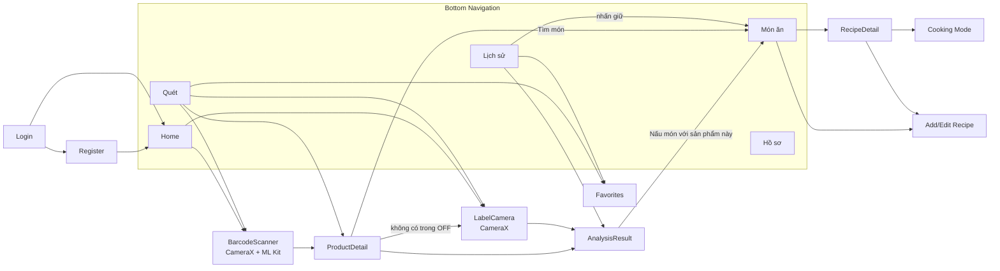
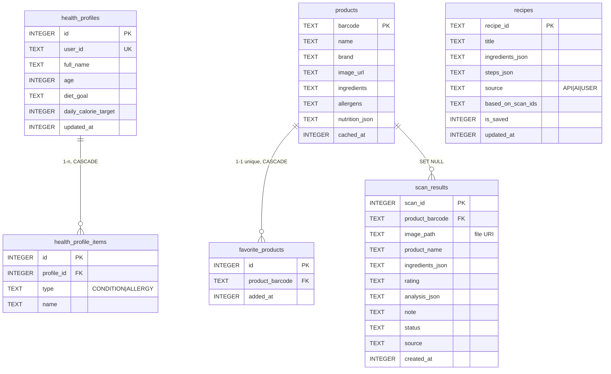

# NutriScan – Kiến trúc & đối chiếu yêu cầu

Tài liệu này đối chiếu code hiện tại với **Proposal (bản sửa)**, **feedback của giảng viên** và các **Milestone 1 / 2 / 04 / 07**.

## 1. Cài đặt nhanh

1. Mở project bằng Android Studio (AGP 9, compileSdk 37, JDK 17+).
2. Thêm vào `local.properties` (file này đã bị `.gitignore`, **không commit key**):

   ```properties
   GEMINI_API_KEY=your_key_from_aistudio.google.com
   # tùy chọn, mặc định gemini-2.5-flash
   GEMINI_MODEL=gemini-2.5-flash
   ```

   Chưa có key app vẫn chạy: quét mã vạch dùng phân tích offline theo luật (`NutritionAnalyzer`), ảnh nhãn nằm trong hàng đợi.
3. Firebase Console → bật **Authentication (Email/Password)** và **Cloud Firestore**. Rule gợi ý:

   ```
   match /users/{userId} { allow read, write: if request.auth != null && request.auth.uid == userId; }
   ```

4. Room DB đổi sang version 2 (`NutriScan_DB`). Lần chạy đầu trên máy cũ sẽ tạo lại DB (destructive migration – dữ liệu v1 chỉ là dữ liệu thử).

## 2. Sơ đồ màn hình (Navigation Component)



## 3. Kiến trúc MVVM

```
Fragment (ViewBinding) ──observe──▶ ViewModel (StateFlow/LiveData, không giữ Context)
                                      │
                                      ▼
                               Repository (Single Source of Truth)
                     ┌────────────────┼──────────────────────┐
                     ▼                ▼                      ▼
             Room DAO (offline)   Retrofit (OFF, MealDB,   Firebase Auth / Firestore
                                  Gemini structured JSON)
```

| Gói | Nội dung |
|---|---|
| `ui/*` | Fragment + ViewModel + Adapter (ListAdapter/DiffUtil) cho từng module |
| `data/local` | `NutriScanDatabase` (Singleton thread-safe), Entity, DAO, TypeConverter |
| `data/remote` | Retrofit API: Open Food Facts, TheMealDB, Gemini (+ `GeminiSchemas`) |
| `data/repository` | Auth, HealthProfile, Product, Scan, Recipe |
| `data/storage` | `ScanImageStorage` – nén JPEG < 1 MB, chỉ trả về file URI |
| `work` | `LabelAnalysisWorker` + `ScanWorkScheduler` (WorkManager, hàng đợi offline) |
| `domain` | `NutritionAnalyzer`, `RecipeCompatibilityChecker` (Kotlin thuần, có unit test) |
| `di` | `ServiceLocator` (manual DI) |

## 4. Database (Room – Milestone 07)



## 5. Đối chiếu feedback giảng viên (Conditionally Approved)

| Ràng buộc | Hiện thực | File |
|---|---|---|
| **#1 Structured JSON trên Gemini** | Mọi `generateContent` đặt `responseMimeType = "application/json"` + `responseSchema`; parse vào DTO nullable trong try/catch `JsonParseException` → trả `AI_INVALID_RESPONSE`, không crash. Prompt không yêu cầu "trả lời JSON". | `data/remote/gemini/GeminiDataSource.kt`, `GeminiSchemas.kt`, test `GeminiDataSourceTest.kt` |
| **#2 Offline Image Queue** | Ảnh CameraX → cacheDir → nén ≤1280 px, JPEG 80→30 tới < 1 MB → `filesDir/scans/{scanId}.jpg`; Room chỉ lưu `file://…` trong `ScanResult.imagePath`. Base64 chỉ tạo trong RAM lúc gửi Gemini. Xóa scan → xóa file. Không entity nào có cột BLOB/Base64. | `data/storage/ScanImageStorage.kt`, `data/repository/ScanRepository.kt`, `work/LabelAnalysisWorker.kt` |
| **#3 Feature Cohesion (Recipe)** | `RecipeRepository.buildQuery()` đọc `HealthProfile` + 10 `ScanResult` gần nhất (SUITABLE/LIMIT) + danh sách loại trừ (dị ứng, AVOID) và truyền làm tham số cho Gemini + TheMealDB `filter.php?i=`. Nút "Nấu món với sản phẩm này" ở Analysis / Product Detail / History (nhấn giữ). Huy hiệu tương thích tính theo HealthProfile. | `data/repository/RecipeRepository.kt`, `ui/recipe/RecipesViewModel.kt`, `domain/RecipeCompatibilityChecker.kt` |

## 6. Đối chiếu Milestone

**Milestone 1 – UI/UX & ConstraintLayout**
- 22 layout XML, mỗi màn hình là 1 `ConstraintLayout` phẳng (chỉ thêm `NestedScrollView` để cuộn và `MaterialCardView` làm khung thẻ).
- Guideline: `fragment_login` (8% top), `fragment_scan_hub`, `fragment_health_profile` (50%), `fragment_barcode_scanner` (45%), `fragment_cooking_mode` (55%).
- Barrier: `fragment_home`, `fragment_analysis_result`, `fragment_health_profile`, `fragment_recipe_detail`.
- Chain: `fragment_home` (spread_inside), `fragment_analysis_result`, `fragment_cooking_mode` (spread). Flow helper: lưới dinh dưỡng `fragment_product_detail`.
- Material 3: `MaterialCardView`, `TextInputLayout` có error (login, register, profile, add recipe, scan hub), `ExtendedFloatingActionButton` (Recipes), Chip/ChipGroup, BottomNavigation, theme sáng/tối.
- `res/values/dimens.xml`, `strings*.xml` (toàn bộ chuỗi tiếng Việt tách theo module).

**Milestone 2 – MVVM & View Binding**
- Không còn `findViewById` (ViewBinding cho Activity/Fragment/Adapter).
- ViewModel không tham chiếu View/Activity/Fragment/Context.
- Quan sát lifecycle-aware: `collectWithLifecycle()` = `viewLifecycleOwner` + `repeatOnLifecycle(STARTED)`; `FavoritesFragment` dùng `LiveData.observe(viewLifecycleOwner)`.
- Mọi Fragment gán `_binding = null` trong `onDestroyView()`.

**Milestone 07 – Room**
- 6 entity, khóa chính/ngoại, index unique, TypeConverter; DAO CRUD dùng `suspend` + `Flow`.
- Singleton thread-safe (`@Volatile` + `synchronized`) → Repository → ViewModel → ViewBinding.
- Test instrumentation: `app/src/androidTest/.../NutriScanDatabaseTest.kt`.

**Milestone 04 – Network & Cloud**
- Retrofit + Coroutines (`Dispatchers.IO` trong `safeApiCall`, gọi từ `viewModelScope`).
- 3 trạng thái UI Loading / Success / Error (`view_network_state.xml`), bắt lỗi Airplane Mode (`ConnectivityInterceptor`), 400/404/429/5xx.
- Firebase Auth (Email/Password, giữ phiên qua lần mở app), Firestore sync hồ sơ.
- Glide trong RecyclerView.Adapter với placeholder, error drawable, memory + disk cache.
- SDK bổ sung: CameraX, ML Kit Barcode, WorkManager, Gemini.
