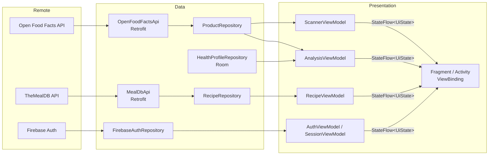

# Milestone 04 — Network Layer, RESTful API & Cloud Services Integration

**Project:** NutriScan · **Course:** Mobile Application Programming (71ITSE30603 / 72ITSE30603)
**Branch:** `feature/network-cloud-integration` · **Pull Request:** `<dán link PR đã merge>` · **Commit hash:** `<dán hash>`
**Video demo (1–2 phút):** `<dán link YouTube unlisted / Google Drive>`

---

## 1. Tổng quan

Milestone này chuyển NutriScan từ dữ liệu giả (chuỗi cố định trong ViewModel) sang hệ thống kết nối mạng thật:

| Hạng mục | Công nghệ | Màn hình |
|---|---|---|
| REST API sản phẩm thực phẩm | Retrofit 3 + Gson + OkHttp, **Open Food Facts** (HTTPS, không cần key) | Tra cứu, Phân tích |
| REST API công thức món ăn | Retrofit 3 + Gson + OkHttp, **TheMealDB** (HTTPS, test key `1`) | Gợi ý |
| Xác thực người dùng | **Firebase Authentication** (Email/Password) + tự lưu phiên | Đăng nhập, Đăng ký |
| Tải ảnh bất đồng bộ | **Glide 5** trong `RecyclerView.Adapter` (placeholder, error fallback, memory + disk cache) | Tra cứu, Gợi ý, Phân tích |
| Dữ liệu cục bộ (từ Milestone 07) | Room — hồ sơ sức khỏe được đối chiếu với dữ liệu API | Hồ sơ, Phân tích |

Toàn bộ danh sách trước đây được viết cứng (`"Gợi ý hôm nay: Salad ức gà, ..."`, `"Sản phẩm an toàn cho người tiểu đường."`) đã được thay bằng dữ liệu từ API.

---

## 2. Kiến trúc MVVM & Single Source of Truth



Luồng bắt buộc: **Retrofit API Service → Repository → ViewModel → StateFlow → ViewBinding UI**.

- **Không có lời gọi API trực tiếp trong Activity/Fragment.** Fragment chỉ gọi hàm của ViewModel; `MainActivity` dùng `SessionViewModel` cho mọi thao tác phiên đăng nhập.
- **Tách luồng:** mọi request chạy trong `viewModelScope.launch { }`; Repository bọc lời gọi bằng `safeApiCall(Dispatchers.IO) { ... }` (`core/network/SafeApiCall.kt`) nên không có tác vụ mạng nào trên Main Thread.
- **Không crash:** `safeApiCall` bắt mọi exception (trừ `CancellationException`) và trả về `NetworkResult.Error(NetworkError, httpCode)`.
- **Dependency:** `di/ServiceLocator.kt` (manual DI) tạo `NetworkModule`, các Repository và `FirebaseAuth`; ViewModel nhận Repository qua `viewModelFactory { initializer { ... } }`.

### Cấu trúc thư mục mới

```text
app/src/main/java/vn/edu/vlu/milestone2/
├── NutriScanApp.kt                    # Application: khởi tạo ServiceLocator
├── core/network/                      # NetworkModule, ConnectivityInterceptor, SafeApiCall, NetworkError, NetworkResult
├── core/ui/                           # UiState, NetworkStateRenderer (3 trạng thái), ImageLoader (Glide), NetworkErrorText
├── data/remote/openfoodfacts/         # OpenFoodFactsApi + DTO
├── data/remote/mealdb/                # MealDbApi + DTO
├── data/model/                        # Product, Nutrition, RecipeSummary, RecipeDetail...
├── data/repository/                   # ProductRepository, RecipeRepository, AuthRepository (+ HealthProfileRepository cũ)
├── domain/NutritionAnalyzer.kt        # Đối chiếu dinh dưỡng (API) với hồ sơ sức khỏe (Room)
├── di/ServiceLocator.kt
└── ui/auth | scanner | analysis | recipe
```

---

## 3. Endpoint Documentation

### 3.1 Bảng endpoint

| # | Tính năng | Method | HTTPS Endpoint | Tham số | Status code được xử lý |
|---|---|---|---|---|---|
| 1 | Tra cứu sản phẩm theo mã vạch | `GET` | `https://world.openfoodfacts.org/api/v2/product/{barcode}.json` | Path `barcode` (8–14 số); Query `fields=code,product_name,brands,quantity,image_front_url,image_url,nutriscore_grade,nova_group,ingredients_text,allergens_tags,nutriments` | 200, 200 + `status:0` (→ 404), 400, 404, 429, 5xx |
| 2 | Tìm sản phẩm theo tên | `GET` | `https://world.openfoodfacts.org/cgi/search.pl` | `search_terms`, `search_simple=1`, `action=process`, `json=1`, `page_size=24`, `fields=code,product_name,brands,image_front_small_url,image_front_url,nutriscore_grade` | 200, 400, 429, 5xx |
| 3 | Danh mục món ăn | `GET` | `https://www.themealdb.com/api/json/v1/1/categories.php` | — | 200, 404, 5xx |
| 4 | Món ăn theo danh mục | `GET` | `https://www.themealdb.com/api/json/v1/1/filter.php` | `c={category}` | 200 (`meals:null` → danh sách rỗng), 404, 5xx |
| 5 | Tìm món theo tên | `GET` | `https://www.themealdb.com/api/json/v1/1/search.php` | `s={query}` | 200 (`meals:null` → danh sách rỗng), 404, 5xx |
| 6 | Chi tiết món | `GET` | `https://www.themealdb.com/api/json/v1/1/lookup.php` | `i={idMeal}` | 200, 200 + `meals:null` (→ 404), 5xx |
| 7 | Đăng ký (Firebase SDK) | `POST` | `https://identitytoolkit.googleapis.com/v1/accounts:signUp` | Gọi qua `createUserWithEmailAndPassword()` | Lỗi Firebase → `AuthError` |
| 8 | Cập nhật tên hiển thị (Firebase SDK) | `POST` | `https://identitytoolkit.googleapis.com/v1/accounts:update` | Gọi qua `FirebaseUser.updateProfile()` | Lỗi Firebase → `AuthError` |
| 9 | Đăng nhập (Firebase SDK) | `POST` | `https://identitytoolkit.googleapis.com/v1/accounts:signInWithPassword` | Gọi qua `signInWithEmailAndPassword()` | Lỗi Firebase → `AuthError` |

> Endpoint 7–9 là REST API tương ứng của Firebase Authentication (Identity Toolkit); ứng dụng gọi chúng gián tiếp qua Firebase Auth SDK chứ không tự gọi bằng Retrofit. Ứng dụng **không dùng** `PUT`/`DELETE` vì hai API công khai trên chỉ cho phép đọc.

### 3.2 JSON payload structure

**(1) `GET /api/v2/product/{barcode}.json` — response**

```json
{
  "code": "8934673573017",
  "status": 1,
  "status_verbose": "product found",
  "product": {
    "code": "8934673573017",
    "product_name": "Sữa tươi tiệt trùng",
    "brands": "Vinamilk",
    "quantity": "180 ml",
    "image_front_url": "https://images.openfoodfacts.org/images/products/.../front.jpg",
    "nutriscore_grade": "b",
    "nova_group": 1,
    "ingredients_text": "Sữa bò tươi...",
    "allergens_tags": ["en:milk"],
    "nutriments": {
      "energy-kcal_100g": 75,
      "sugars_100g": 4.5,
      "fat_100g": 3.5,
      "saturated-fat_100g": 2.3,
      "salt_100g": 0.1,
      "proteins_100g": 3.1,
      "carbohydrates_100g": 4.8,
      "fiber_100g": 0
    }
  }
}
```

Khi không có mã vạch: `{"code": "...", "status": 0, "status_verbose": "product not found"}` → app hiển thị lỗi *Không tìm thấy dữ liệu (HTTP 404)*.
Ánh xạ DTO: `data/remote/openfoodfacts/OpenFoodFactsDtos.kt` (`ProductResponseDto`, `ProductDto`, `NutrimentsDto`).

**(2) `GET /cgi/search.pl` — response**

```json
{
  "count": 125,
  "products": [
    {
      "code": "8934673573017",
      "product_name": "Sữa tươi tiệt trùng",
      "brands": "Vinamilk",
      "image_front_small_url": "https://images.openfoodfacts.org/.../front.200.jpg",
      "nutriscore_grade": "b"
    }
  ]
}
```

**(3) `GET categories.php` — response**

```json
{ "categories": [ { "idCategory": "1", "strCategory": "Beef", "strCategoryThumb": "https://www.themealdb.com/images/category/beef.png" } ] }
```

**(4)(5) `GET filter.php?c=` / `search.php?s=` — response**

```json
{ "meals": [ { "idMeal": "52959", "strMeal": "Baked salmon with fennel & tomatoes", "strMealThumb": "https://www.themealdb.com/images/media/meals/....jpg" } ] }
```

Không có kết quả: `{ "meals": null }` → `UiState.Success(emptyList())` → hiển thị *Không có dữ liệu phù hợp*.

**(6) `GET lookup.php?i=` — response (rút gọn)**

```json
{
  "meals": [{
    "idMeal": "52772", "strMeal": "Teriyaki Chicken Casserole",
    "strCategory": "Chicken", "strArea": "Japanese",
    "strInstructions": "Preheat oven...", "strMealThumb": "https://...jpg",
    "strYoutube": "https://www.youtube.com/watch?v=...",
    "strIngredient1": "soy sauce", "strMeasure1": "3/4 cup",
    "strIngredient20": "", "strMeasure20": ""
  }]
}
```

20 cặp `strIngredientN/strMeasureN` được đọc dạng `Map<String, String?>` và gộp thành danh sách nguyên liệu trong `RecipeRepository`.

**(7)(9) Firebase Auth — request body do SDK gửi**

```json
{ "email": "user@example.com", "password": "******", "returnSecureToken": true }
```

### 3.3 Xử lý lỗi & HTTP status code

| Tình huống | Exception / dấu hiệu | `NetworkError` | Thông báo hiển thị (banner đỏ + nút *Thử lại*) |
|---|---|---|---|
| Chế độ máy bay / mất Wi-Fi | `NoConnectivityException` (từ `ConnectivityInterceptor`), `UnknownHostException`, `ConnectException` | `NO_INTERNET` | Không có kết nối Internet. Hãy tắt Chế độ máy bay hoặc kiểm tra Wi-Fi/4G. |
| Timeout (connect 15 s, read 20 s) | `SocketTimeoutException` | `TIMEOUT` | Máy chủ phản hồi quá lâu. Vui lòng thử lại. |
| HTTP 400 | `HttpException(400)` | `BAD_REQUEST` | Yêu cầu không hợp lệ. (HTTP 400) |
| HTTP 401 / 403 | `HttpException` | `UNAUTHORIZED` | Không có quyền truy cập dữ liệu. |
| HTTP 404 hoặc `status:0` / `meals:null` khi tra 1 bản ghi | `HttpException(404)` | `NOT_FOUND` | Không tìm thấy dữ liệu. (HTTP 404) |
| HTTP 429 (Open Food Facts giới hạn ~10 lượt tìm/phút) | `HttpException(429)` | `TOO_MANY_REQUESTS` | Bạn thao tác quá nhanh... |
| HTTP 500–599 | `HttpException(5xx)` | `SERVER` | Máy chủ đang gặp sự cố. (HTTP 500) |
| JSON sai định dạng | `JsonParseException`, `NumberFormatException` | `PARSE` | Dữ liệu trả về không hợp lệ. |
| Lỗi Firebase | `FirebaseAuthInvalidCredentialsException`, `...UserCollisionException`, `...WeakPasswordException`, `FirebaseNetworkException`, `FirebaseTooManyRequestsException` | `AuthError` | Email hoặc mật khẩu không đúng / Email đã được đăng ký / Không có kết nối mạng... |

Kiểm chứng tự động: `app/src/test/.../ProductRepositoryTest.kt` dùng **MockWebServer** để giả lập 200, `status:0`, 400, 404, 500, JSON hỏng và không phản hồi (timeout); `RecipeRepositoryTest.kt` kiểm tra `meals:null` và ghép nguyên liệu.

### 3.4 Ba trạng thái UI

`core/ui/UiState.kt`: `Idle | Loading | Success<T> | Error(NetworkError, httpCode)`.
`core/ui/NetworkStateRenderer.kt` → `ViewNetworkStateBinding.showState(state, content, onRetry)` bật đúng 1 khối:

- **Loading** — `ProgressBar` trong `view_network_state.xml`.
- **Success** — `RecyclerView` (`ListAdapter` + `DiffUtil`) qua ViewBinding (`ItemProductBinding`, `ItemRecipeBinding`).
- **Error** — `MaterialCardView` banner đỏ, icon mất mạng, thông báo tiếng Việt và nút **Thử lại** (gọi `viewModel.retry()`).

Áp dụng cho: Tra cứu (`ScannerFragment`), Phân tích (`AnalysisFragment`), Gợi ý (`RecipeFragment`); màn hình Đăng nhập/Đăng ký có ProgressBar + thông báo lỗi riêng.

---

## 4. Cloud Services & Third-Party SDKs

### 4.1 Firebase Authentication

- `FirebaseAuthRepository` bọc `signInWithEmailAndPassword`, `createUserWithEmailAndPassword`, `updateProfile`, `signOut`; dùng `kotlinx-coroutines-play-services` (`Task.await()`) trong `Dispatchers.IO`.
- **Session persistence:** Firebase tự lưu token trên thiết bị. Khi mở app, `MainActivity` hỏi `SessionViewModel.isLoggedIn` và đặt `startDestination` = **Hồ sơ** nếu đã đăng nhập, ngược lại = **Đăng nhập**. Không cần đăng nhập lại sau khi tắt/mở app.
- `SessionViewModel.currentUser` lắng nghe `AuthStateListener` (qua `callbackFlow`); khi bấm **Đăng xuất** trên toolbar, app tự quay về màn hình Đăng nhập và xóa back stack.
- Kiểm tra đầu vào trong `AuthViewModel` (email hợp lệ, mật khẩu ≥ 6 ký tự, nhập lại khớp) — có unit test `AuthViewModelTest`.

### 4.2 Firebase Architecture Proof (nhóm tự chụp)

1. Vào <https://console.firebase.google.com> → **Add project** (ví dụ `nutriscan-vlu`).
2. **Add app → Android**, package name: `vn.edu.vlu.milestone2` → tải `google-services.json` → đặt vào thư mục `app/`.
3. **Build → Authentication → Get started → Sign-in method → Email/Password → Enable**.
4. Chạy app, đăng ký 2–3 tài khoản.
5. Chụp màn hình:
   - **Authentication → Users** (thấy danh sách người dùng đã đăng ký, cột *Created* / *Signed in*).
   - **Authentication → Sign-in method** (Email/Password = *Enabled*) và **Authentication → Settings** (User actions / Password policy).

> `[Chèn ảnh Firebase Console – Users]`
> `[Chèn ảnh Firebase Console – Sign-in method / Settings]`

### 4.3 Glide — tải ảnh bất đồng bộ

`core/ui/ImageLoader.kt` — được gọi trong `ProductAdapter`, `RecipeAdapter` và `AnalysisFragment`:

```kotlin
Glide.with(this)
    .load(url)
    .placeholder(R.drawable.ic_image_placeholder)   // trong lúc tải
    .error(R.drawable.ic_image_error)                // URL hỏng / mất mạng
    .fallback(R.drawable.ic_image_error)             // URL null
    .skipMemoryCache(false)                          // memory cache
    .diskCacheStrategy(DiskCacheStrategy.AUTOMATIC)  // disk cache
    .centerCrop()
    .transition(DrawableTransitionOptions.withCrossFade())
    .into(this)
```

`onViewRecycled()` gọi `Glide.clear()` để tránh ảnh hiển thị sai vị trí khi ViewHolder được tái sử dụng.

### 4.4 SDK theo domain

- **Open Food Facts** (cơ sở dữ liệu dinh dưỡng mở) + `NutritionAnalyzer`: đối chiếu đường/muối/chất béo bão hòa/chất gây dị ứng/năng lượng của sản phẩm với hồ sơ sức khỏe trong Room → kết luận *Phù hợp / Nên hạn chế / Không nên sử dụng*. Ngưỡng theo nhãn đèn giao thông FSA (đường > 22,5 g, muối > 1,5 g, béo bão hòa > 5 g trên 100 g).

---

## 5. Thư viện đã thêm (`gradle/libs.versions.toml`)

| Thư viện | Phiên bản |
|---|---|
| `com.squareup.retrofit2:retrofit`, `converter-gson` | 3.0.0 |
| `com.squareup.okhttp3:logging-interceptor` (+ `mockwebserver` cho test) | 4.12.0 |
| `com.github.bumptech.glide:glide` | 5.0.5 |
| `com.google.firebase:firebase-bom` → `firebase-auth` | 34.14.1 |
| Plugin `com.google.gms.google-services` | 4.4.4 |
| `org.jetbrains.kotlinx:kotlinx-coroutines-play-services`, `-test` | 1.10.2 |
| `androidx.lifecycle:lifecycle-viewmodel-ktx`, `-runtime-ktx` | 2.9.4 |
| `androidx.recyclerview:recyclerview` | 1.4.0 |

Quyền mới trong `AndroidManifest.xml`: `INTERNET`, `ACCESS_NETWORK_STATE`.

---

## 6. Work Breakdown Structure (WBS)

Mỗi thành viên sở hữu **một lát cắt dọc hoàn chỉnh** (UI + ViewModel + Repository + API/Firebase).

| Thành viên | Feature slice | File chính | Số commit |
|---|---|---|---|
| `[Tên 1]` | **Core Network Layer** — Retrofit/OkHttp, `safeApiCall`, `NetworkError`, `UiState`, `ConnectivityInterceptor`, banner lỗi dùng chung, Glide `ImageLoader` | `core/**`, `di/ServiceLocator.kt`, `NutriScanApp.kt`, `view_network_state.xml`, Gradle | `[x]` |
| `[Tên 2]` | **Firebase Authentication** — Đăng nhập/Đăng ký, lưu phiên, Đăng xuất | `ui/auth/**`, `AuthRepository.kt`, `MainActivity.kt`, `nav_graph.xml`, `AuthViewModelTest.kt` | `[x]` |
| `[Tên 3]` | **Product Search (Open Food Facts)** — tìm theo tên, RecyclerView + Glide, nhập mã vạch | `ui/scanner/**`, `ProductRepository.kt`, `data/remote/openfoodfacts/**`, `ProductRepositoryTest.kt` | `[x]` |
| `[Tên 4]` | **Product Analysis** — gọi API theo mã vạch + đối chiếu hồ sơ Room | `ui/analysis/**`, `domain/NutritionAnalyzer.kt`, `NutritionAnalyzerTest.kt` | `[x]` |
| `[Tên 5]` | **Recipe Recommendation (TheMealDB)** — danh mục, tìm kiếm, lưới ảnh, chi tiết món | `ui/recipe/**`, `RecipeRepository.kt`, `data/remote/mealdb/**`, `RecipeRepositoryTest.kt` | `[x]` |

Lấy số commit thật của từng người:

```bash
git shortlog -sne main..feature/network-cloud-integration
```

> Nếu nhóm có 4 người, gộp *Core Network Layer* vào slice của trưởng nhóm. Điền tên và số commit đúng với lịch sử GitHub.

---

## 7. Hướng dẫn chạy & kịch bản video demo

**Chạy dự án**

1. Đặt `google-services.json` (mục 4.2) vào `app/`.
2. Android Studio → *Sync Project with Gradle Files* → Run trên emulator/thiết bị có Internet.
3. Unit test: `./gradlew :app:testDebugUnitTest`.

**Kịch bản video (1–2 phút)**

| Thời điểm | Nội dung |
|---|---|
| 0:00–0:20 | Mở app → màn hình Đăng nhập → bấm *Đăng ký*, tạo tài khoản → vào Hồ sơ (toolbar hiện “Xin chào, …”). |
| 0:20–0:30 | Tắt hẳn app, mở lại → vào thẳng Hồ sơ (**session persistence**). Mở Firebase Console → Users thấy tài khoản mới. |
| 0:30–0:55 | Tab **Tra cứu**: ProgressBar → danh sách sản phẩm có ảnh (Glide). Tìm “milk” → chọn 1 sản phẩm → **Phân tích** hiển thị ảnh, Nutri-Score, cảnh báo theo hồ sơ. |
| 0:55–1:10 | Nhập mã vạch không tồn tại (ví dụ `12345678`) → banner *Không tìm thấy dữ liệu (HTTP 404)*. |
| 1:10–1:25 | Tab **Gợi ý**: chọn danh mục → lưới món ăn có ảnh → bấm 1 món xem nguyên liệu. |
| 1:25–1:50 | Bật **Chế độ máy bay** → bấm *Tìm* / chuyển danh mục → banner *Không có kết nối Internet…* (app không crash) → tắt Chế độ máy bay → bấm **Thử lại** → dữ liệu hiện lại. |
| 1:50–2:00 | Bấm **Đăng xuất** → quay về Đăng nhập. |

---

## 8. Git workflow

```bash
git checkout -b feature/network-cloud-integration
# mỗi thành viên commit phần của mình
git push -u origin feature/network-cloud-integration
# GitHub → Compare & pull request → base: main → review → Merge pull request
```
