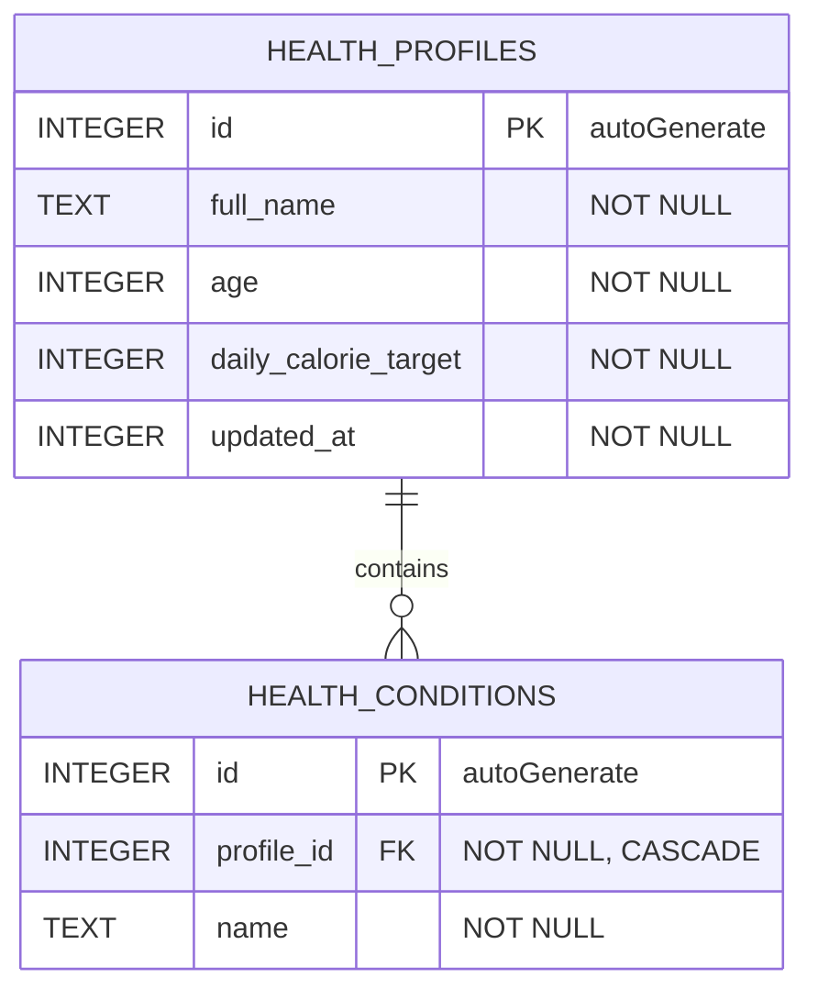

# Milestone 07 — Local Offline Persistence Layer

## 1. Core feature

NutriScan stores **Health Profiles** locally so the analysis and recipe modules can read the user's age, daily calorie target, and health conditions without a network connection. The profile screen supports create, read, update, and delete operations, with reactive updates from Room `Flow`.

## 2. Database schema map



Constraints:

- `health_profiles.id` and `health_conditions.id` are auto-generated primary keys.
- `health_conditions.profile_id` references `health_profiles.id` with `ON UPDATE CASCADE` and `ON DELETE CASCADE`.
- A unique composite index on `(profile_id, name)` prevents duplicate conditions within one profile.
- A separate index on `profile_id` makes relationship queries efficient.

## 3. MVVM and Room integration

```text
ViewBinding UI (HealthProfileFragment)
        ↓ events / observes StateFlow
ProfileViewModel
        ↓ suspend functions / Flow
HealthProfileRepository
        ↓ entity-domain mapping
HealthProfileDao
        ↓ @Transaction CRUD queries
NutriScanDatabase (thread-safe singleton)
        ↓
SQLite: nutriscan.db
```

The DAO saves a profile and its conditions in one transaction. Updating a profile replaces its child conditions atomically. Deleting the parent automatically deletes its conditions through the foreign-key cascade.

## 4. Database Inspector proof

1. Run the app on an emulator or device and open **Hồ sơ**.
2. Save at least one profile with two health conditions.
3. In Android Studio, open **App Inspection → Database Inspector**.
4. Select the running `vn.edu.vlu.milestone2` process and expand `nutriscan.db`.
5. Capture one screenshot showing populated `health_profiles` and `health_conditions` tables.

> Insert the Database Inspector screenshot here before exporting this document to PDF.

## 5. Team contribution matrix (WBS)

| Team member | Assigned work | Evidence |
|---|---|---|
| `[Name 1]` | Room entities, relationship, database singleton | Entity and database source files |
| `[Name 2]` | DAO CRUD, repository, coroutine `Flow` | DAO and repository source files |
| `[Name 3]` | ViewModel, validation, ViewBinding UI | Profile UI source files |
| `[Name 4]` | Instrumented test, Database Inspector, report and PR review | Test, screenshot, report, PR review |

Replace the placeholders with real member names and adjust tasks to match the actual Git/PR history.
